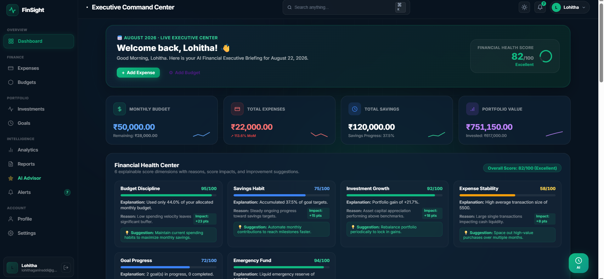
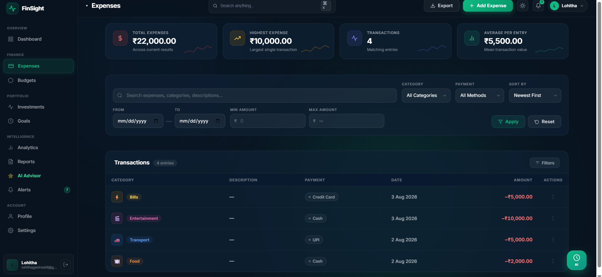
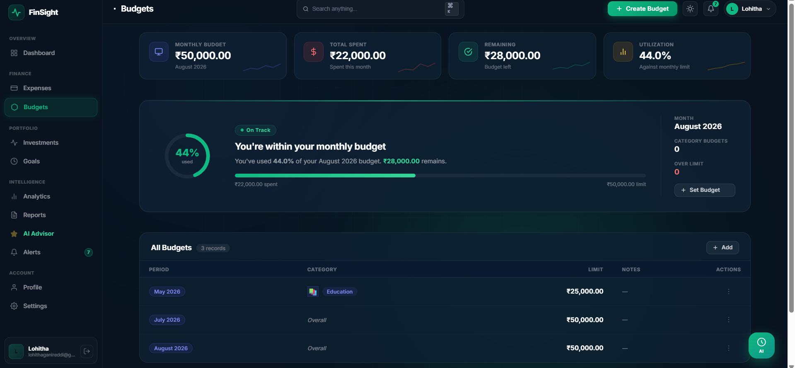
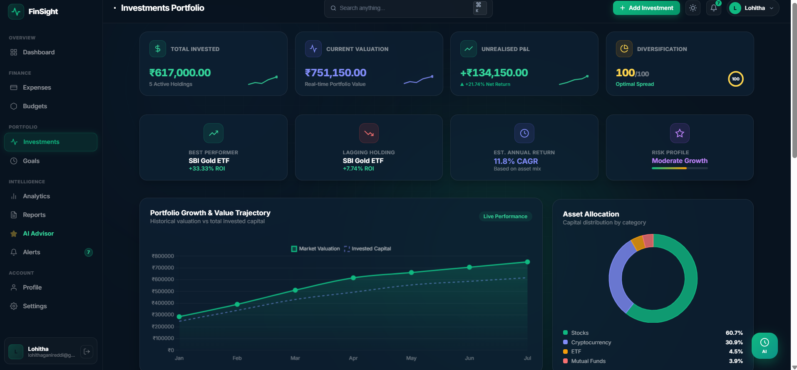
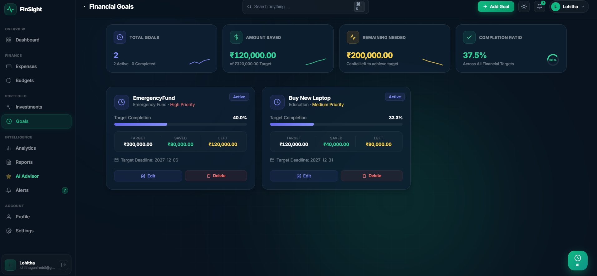
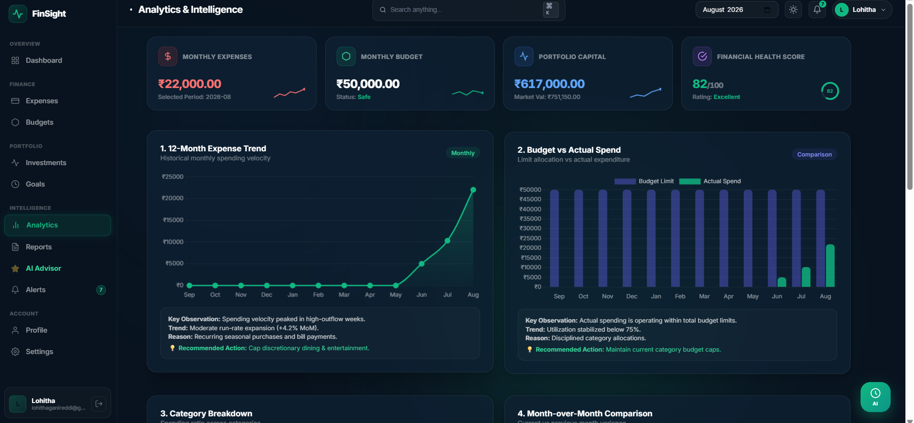
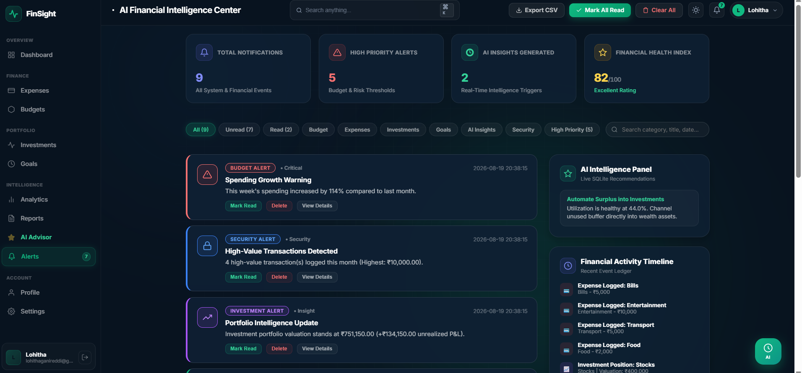

# 💰 FinSight — Personal Finance & Investment Intelligence Platform

> **Smart Finance. Smarter Decisions.**

FinSight is a web-based **Personal Finance & Investment Intelligence Platform** designed to help users manage their expenses, budgets, investments, financial goals, and overall financial health from a single dashboard.

The platform combines **expense tracking, budget management, investment monitoring, financial analytics, personalized recommendations, and financial health insights** to help users understand their financial behavior and make smarter financial decisions.

---

## 📌 Table of Contents

* [Overview](#-overview)
* [Problem Statement](#-problem-statement)
* [Objectives](#-objectives)
* [Key Features](#-key-features)
* [Financial Intelligence](#-financial-intelligence)
* [Financial Health Score](#-financial-health-score)
* [Technology Stack](#-technology-stack)
* [System Architecture](#-system-architecture)
* [Project Structure](#-project-structure)
* [Database](#-database)
* [Authentication & Security](#-authentication--security)
* [Dashboard](#-dashboard)
* [Expense Management](#-expense-management)
* [Budget Management](#-budget-management)
* [Investment Management](#-investment-management)
* [Goal Management](#-goal-management)
* [Analytics & Insights](#-analytics--insights)
* [Milestones](#-milestones)
* [Installation](#-installation)
* [Running the Application](#-running-the-application)
* [Configuration](#-configuration)
* [Future Enhancements](#-future-enhancements)
* [Project Benefits](#-project-benefits)
* [Learning Outcomes](#-learning-outcomes)
* [Author](#-author)
* [License](#-license)

---

# 🌟 Overview

Managing personal finances manually can make it difficult to understand spending patterns, control budgets, track investments, and evaluate financial progress.

**FinSight** addresses this problem by providing a centralized financial management platform where users can:

* Track daily expenses
* Categorize spending
* Set and monitor budgets
* Manage investments
* Create financial goals
* Monitor financial health
* Analyze spending patterns
* View financial trends
* Receive personalized financial recommendations
* Understand important financial insights through an intuitive dashboard

The application is designed with a modern, responsive interface using a **glassmorphism-inspired visual design**.

---

# 🎯 Problem Statement

Many individuals use separate applications, spreadsheets, or manual methods for managing different aspects of their finances.

This creates several problems:

* Difficulty tracking daily expenses
* Poor visibility into spending patterns
* Lack of centralized financial information
* Difficulty maintaining budgets
* Limited understanding of financial health
* Lack of personalized financial recommendations
* Difficulty monitoring investments and goals

FinSight aims to solve these problems by bringing essential personal finance management capabilities together in one platform.

---

# 🎯 Objectives

The major objectives of FinSight are:

1. Provide a centralized platform for personal finance management.
2. Allow users to record and categorize expenses.
3. Help users create and monitor monthly budgets.
4. Provide investment tracking capabilities.
5. Allow users to create and monitor financial goals.
6. Analyze financial behavior and spending patterns.
7. Generate personalized budget recommendations.
8. Calculate an understandable financial health score.
9. Present financial information through interactive dashboards and charts.
10. Provide a clean and user-friendly financial management experience.

---

# 🚀 Key Features

## 🔐 User Authentication

* User registration
* User login
* Secure password handling
* Session-based authentication
* User-specific financial data

---

## 💸 Expense Management

Users can manage their daily expenses by:

* Adding expenses
* Recording transaction amounts
* Selecting expense categories
* Adding descriptions
* Viewing transaction history
* Searching expenses
* Filtering expenses
* Sorting expenses
* Monitoring spending patterns

---

## 💰 Budget Management

FinSight allows users to create and monitor budgets.

Features include:

* Monthly budget creation
* Budget utilization tracking
* Remaining budget calculation
* Spending progress indicators
* Budget status visualization
* Budget threshold monitoring
* Personalized budget recommendations

---

## 📈 Investment Management

The investment module provides functionality for managing investment information.

Users can:

* Add investments
* Track investment-related information
* View portfolio information
* Monitor investment allocation
* Analyze portfolio-related data

---

## 🎯 Financial Goals

Users can create financial goals and monitor their progress.

Examples include:

* Saving for education
* Emergency funds
* Travel goals
* Major purchases
* Long-term financial objectives

Goal progress can be used as part of the overall financial intelligence and health analysis.

---

# 🧠 Financial Intelligence

One of the major enhancements of FinSight is its **Financial Intelligence Engine**.

The intelligence layer analyzes user financial data and generates meaningful financial information.

The system considers factors such as:

* Today's spending
* Previous-day spending
* Weekly spending
* Monthly spending
* Average daily spending
* Highest transaction
* Highest spending category
* Lowest spending category
* Budget utilization
* Goal completion
* Investment allocation

This transforms raw financial transactions into more understandable financial insights.

---

# 🤖 Personalized Budget Recommendations

FinSight can generate personalized recommendations based on the user's financial behavior.

The recommendation engine considers:

* Month-over-month spending variation
* Budget utilization
* Budget thresholds
* Spending categories
* Financial behavior

Important budget thresholds include:

* **80% utilization** → Warning / attention
* **100% utilization** → Budget exceeded

Recommendations are prioritized so that important financial actions can be highlighted to the user.

---

# ❤️ Financial Health Score

FinSight includes an explainable **Financial Health Score** designed to provide users with a simple representation of their overall financial condition.

Instead of displaying only a number, the system can identify:

### Positive Factors

Financial behaviors contributing positively to the user's score.

### Attention Items

Financial areas that may require improvement.

The health score uses different visual states:

| Score Range | Status             |
| ----------- | ------------------ |
| 85 – 100    | 🟢 Excellent       |
| 65 – 84     | 🟡 Needs Attention |
| Below 65    | 🔴 Critical        |

The dashboard also uses a visual circular progress indicator to make the score easier to understand.

---

# 📊 Dashboard

The FinSight dashboard provides a centralized view of important financial information.

The dashboard can include:

### Key Performance Indicators

* Monthly Budget
* Total Expenses
* Remaining Budget
* Portfolio Value

### Financial Analytics

* Budget utilization
* Expense category distribution
* Recent transactions
* Spending trends
* Financial health
* Investment information
* Goal progress

### Interactive Charts

FinSight uses **Chart.js** to present financial information visually.

Examples include:

* Category-wise spending
* Monthly spending trends
* Budget utilization
* Financial trends

---

# 🔎 Analytics & Insights

FinSight converts financial data into useful information through:

* Spending analysis
* Category analysis
* Monthly trends
* Budget utilization
* Transaction analysis
* Financial health evaluation
* Goal progress
* Investment allocation analysis

The objective is to help users understand not just **what they spent**, but also **how their financial behavior is changing over time**.

---

# 🛠️ Technology Stack

## Frontend

* HTML5
* CSS3
* JavaScript
* Chart.js
* Jinja2 Templates

## Backend

* Python
* Flask

## Database

* SQLite

## Development Tools

* Visual Studio Code
* Git
* GitHub
* Jupyter Notebook where applicable

---

# 🏗️ System Architecture

FinSight follows a web application architecture consisting of three major layers:

```text
                ┌──────────────────────────┐
                │        User / Browser    │
                └────────────┬─────────────┘
                             │
                             ▼
                ┌──────────────────────────┐
                │     Frontend Layer       │
                │ HTML / CSS / JavaScript  │
                │      Chart.js / Jinja    │
                └────────────┬─────────────┘
                             │
                             ▼
                ┌──────────────────────────┐
                │      Flask Backend       │
                │      Application Logic   │
                │        app.py            │
                └────────────┬─────────────┘
                             │
              ┌──────────────┴──────────────┐
              ▼                             ▼
   ┌────────────────────┐        ┌────────────────────┐
   │ Financial Services │        │   Database Layer   │
   │  Intelligence      │        │      SQLite        │
   │ Recommendations    │        │                    │
   │ Health Score       │        │  Users             │
   └────────────────────┘        │  Expenses          │
                                 │  Budgets           │
                                 │  Investments       │
                                 │  Goals             │
                                 └────────────────────┘
```

---

# 📁 Project Structure

The major project components are organized approximately as follows:

```text
FinSight/
│
├── app.py
├── database.py
├── services.py
├── requirements.txt
│
├── instance/
│   └── finsight.db
│
├── static/
│   ├── css/
│   │   └── style.css
│   │
│   └── js/
│       └── app.js
│
├── templates/
│   ├── login.html
│   ├── register.html
│   ├── dashboard.html
│   ├── expenses.html
│   ├── budgets.html
│   ├── investments.html
│   ├── investment_form.html
│   ├── goals.html
│   ├── goal_form.html
│   ├── reports.html
│   ├── profile.html
│   ├── settings.html
│   └── 403.html
│
└── README.md
```

> The exact file structure may vary slightly depending on the final version of the project.

---

# 🗄️ Database

FinSight uses **SQLite** as its database.

The database stores user-specific financial information.

Major entities include:

### Users

Stores authentication and user-related information.

### Expenses

Stores financial transactions and expense information.

### Budgets

Stores monthly budget information.

### Investments

Stores investment-related information.

### Goals

Stores financial goal information.

### Notifications

Supports the notification and financial alert functionality.

Foreign-key relationships are used where appropriate to maintain data integrity.

---

# 🔐 Authentication & Security

FinSight includes user authentication and secure password handling.

Password processing uses secure hashing techniques.

The application also uses user sessions to ensure that financial information is associated with the authenticated user.

The database configuration enables:

```text
PRAGMA foreign_keys = ON
```

This helps maintain referential integrity between related database records.

---

# 🎨 UI / UX Design

FinSight uses a modern financial dashboard design inspired by **glassmorphism**.

### Design Characteristics

* Dark financial dashboard theme
* Glass-style cards
* Rounded components
* Soft shadows
* Modern typography
* Responsive layouts
* Interactive charts
* Visual status indicators
* Consistent spacing
* Clear information hierarchy

### Core Design Tokens

```text
Primary Background : #081A2F
Accent             : #10B981
Text               : #FFFFFF
Glass Card         : rgba(255,255,255,0.08)
Font               : Inter
```

The design emphasizes clarity so that financial information can be understood quickly.

---

# 📈 Expense Analysis

FinSight provides multiple ways to understand spending behavior.

Users can analyze:

* Total expenses
* Category-wise spending
* Recent transactions
* Monthly spending
* Spending trends
* Highest transactions
* Budget utilization

The application can use this information to generate financial insights and recommendations.

---

# 💡 Smart Financial Insights

The intelligence layer can identify patterns such as:

* High spending categories
* Increasing expenses
* Budget over-utilization
* Budget thresholds being reached
* Changes in monthly spending
* Financial goal progress
* Investment allocation

These insights are designed to help users make more informed financial decisions.

---

# 🔔 Notifications

FinSight includes a notification-oriented architecture for communicating important financial events and recommendations.

Potential notification scenarios include:

* Budget threshold warnings
* Budget exceeded alerts
* Financial recommendations
* Important account-related information

---

# 📋 Milestone Development

## Milestone 1 — Core Finance Management

The first milestone established the foundation of FinSight.

### Major components

* User authentication
* Login and registration
* Expense tracking
* Budget management
* Basic dashboard
* SQLite database integration

The focus of Milestone 1 was establishing the core personal finance management functionality.

---

## Milestone 2 — Dashboard & Module Refinement

The second milestone focused on improving the usability and presentation of the core finance modules.

### Major improvements

* Enhanced expense management
* Improved dashboard
* Better financial summaries
* Improved budget visualization
* Improved user interface
* Interactive financial charts
* Better organization of financial information

---

## Milestone 3 — Financial Intelligence

Milestone 3 focused on transforming FinSight from a basic finance tracker into a more intelligent financial management platform.

### Major components

* Financial Intelligence Engine
* Personalized Budget Recommendations
* Explainable Financial Health Score
* Notification Center
* Advanced Dashboard Insights
* Financial Analytics
* Goal and investment analysis

This milestone introduced intelligence-driven financial analysis instead of simply displaying stored transactions.

---

# ⚙️ Installation

## 1. Clone the Repository

```bash
git clone https://github.com/lohithaganireddi/infosysFinsit.git
```

Navigate to the project directory:

```bash
cd infosysFinsit
```

---

## 2. Create a Virtual Environment

### Windows

```bash
python -m venv venv
```

Activate it:

```bash
venv\Scripts\activate
```

### macOS / Linux

```bash
python3 -m venv venv
```

Activate it:

```bash
source venv/bin/activate
```

---

## 3. Install Dependencies

```bash
pip install -r requirements.txt
```

---

# ▶️ Running the Application

After installing the required dependencies, start the Flask application:

```bash
python app.py
```

The application will normally be available at:

```text
http://127.0.0.1:5000/
```

Open the address in your web browser.

---

# ⚙️ Configuration

Before deploying the application publicly, configure appropriate environment variables for sensitive configuration such as:

* Flask secret key
* Database configuration
* Email configuration if enabled
* Other application credentials

Sensitive credentials should **never be committed to GitHub**.

A `.gitignore` file should be used to prevent files containing secrets or local configuration from being committed.

---

# 🧪 Testing

The application can be tested by verifying the major user workflows:

### Authentication

* Register a new user
* Log in
* Log out

### Expenses

* Add an expense
* Search expenses
* Filter expenses
* Sort expenses
* Verify dashboard totals

### Budgets

* Create a budget
* Add expenses
* Verify budget utilization
* Check budget warnings

### Investments

* Add investment information
* Verify portfolio information

### Goals

* Create a financial goal
* Monitor progress

### Financial Intelligence

* Verify financial insights
* Check budget recommendations
* Verify health score changes based on financial data

---

# 🔮 Future Enhancements

FinSight can be further extended with advanced financial intelligence capabilities.

Possible future improvements include:

* AI-powered financial assistant
* Automated expense categorization
* Bank account integration
* UPI transaction integration
* Investment market data integration
* Stock and mutual fund tracking
* Advanced predictive analytics
* Expense forecasting
* Personalized savings plans
* Financial report generation
* PDF/Excel financial reports
* Email and mobile notifications
* Multi-currency support
* Advanced authentication
* Cloud database integration
* Mobile application
* Machine-learning-based spending prediction

---

# 🌱 Project Benefits

FinSight provides several practical benefits:

### For Users

* Centralized financial management
* Better expense awareness
* Improved budgeting
* Easier investment tracking
* Goal monitoring
* Financial health awareness
* Personalized recommendations

### For Learning

The project demonstrates practical implementation of:

* Python programming
* Flask web development
* Database management
* SQL
* HTML/CSS/JavaScript
* REST-style application design
* Data visualization
* Financial analytics
* Authentication
* Software engineering practices

---

# 🎓 Learning Outcomes

Through the development of FinSight, the project demonstrates experience in:

* Full-stack web application development
* Backend development using Flask
* Database design using SQLite
* Frontend development
* JavaScript-based interactivity
* Data visualization with Chart.js
* User authentication
* Financial data analysis
* Modular application design
* Git and GitHub version control
* Debugging and code refinement
* UI/UX design
* Development through milestone-based implementation

---

# 🏆 Project Highlights

> ### 💰 Personal Finance Management
>
> Track expenses, budgets, investments, and goals in one platform.

> ### 🧠 Financial Intelligence
>
> Transform financial records into meaningful insights.

> ### 📊 Interactive Analytics
>
> Visualize spending and financial trends through charts and dashboards.

> ### ❤️ Financial Health
>
> Understand overall financial condition through an explainable health score.

> ### 💡 Personalized Recommendations
>
> Receive recommendations based on financial behavior and budget utilization.

> ### 🎨 Modern Interface
>
> Manage finances through a clean, modern glassmorphism-inspired dashboard.

---

# 📸 Screenshots

## 🏠 Dashboard



## 💸 Expense Management



## 💰 Budget Management



## 📈 Investment Management



## 🎯 Financial Goals



## ❤️ Financial Health & Insights



## 🔔 Notifications



# 🤝 Contribution

This project was developed as an academic/internship project.

Future contributors can improve FinSight by:

1. Forking the repository.
2. Creating a feature branch.
3. Implementing the enhancement.
4. Testing the changes.
5. Creating a pull request.

---

# 📄 License

This project is developed for educational and internship purposes.

If the project is later released as open source, an appropriate open-source license such as MIT can be added.

---

# 👩‍💻 Author

## Lohitha Sai Priya Devi Ganireddi

**B.Tech — Computer Science & Engineering (Artificial Intelligence & Machine Learning)**

### FinSight

**Personal Finance & Investment Intelligence Platform**

> *Smart Finance. Smarter Decisions.*

---

# ⭐ Acknowledgements

This project was developed as part of an **Infosys Springboard Virtual Internship** project.

Special thanks to the mentors and learning resources that supported the development and refinement of the project.

---

## 💚 FinSight

**Track your money. Understand your finances. Make smarter decisions.**

---
